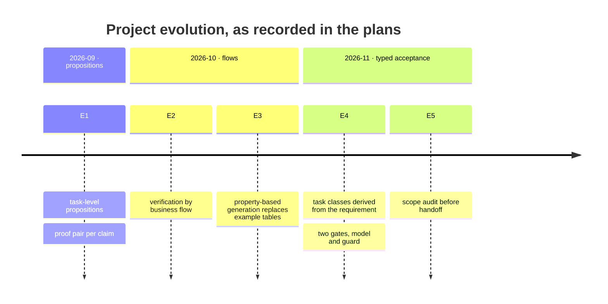
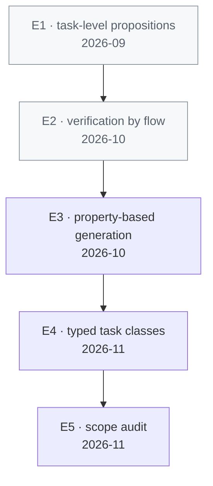
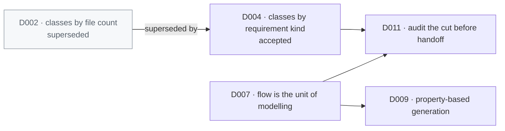

# Drawing the history

Three shapes, and the rules that keep them honest. Copy-paste sources are in `pdd:study`'s
`references/mermaid-templates.md` (§1 flowchart, §3 state, §6 requirement, and the timeline section of the
standalone library); this file decides what goes in them.

## 1. The timeline — the evolution

One `timeline` per project, split by year or by era when it passes a screen. Each entry is an era id, a date,
and the one clause that changed.

Rules:

- **one entry per `E` record**, dated, and the date is the one the record carries (never a rounded month);
- **the section names the era**, not the subsystem — a timeline of subsystems is a mindmap in disguise;
- **`undated` is allowed and visible.** A reader who sees `undated` knows to distrust the ordering; a reader who
  sees a plausible month does not;
- **no counts in the labels** ("14 decisions") — counts change on every re-run and the diagram then has to be
  edited to stay true.

## 2. The era flowchart — what changed, in order

When there are more than about eight eras, or when the eras branch (a decision rejected in one era returns
later), draw the order as a `flowchart TD` instead of a timeline. Era nodes are rectangles labelled `E3`, with
the clause under them; the edges are "superseded by" or "revisited by".

Shading an era that no longer governs is decoration; the `status` in the register is the claim. If you shade,
say in the caption what the shading means.

## 3. The decision graph — what decided what

The primary diagram: every decision once, edges for `supersedes` and `caused`, so a reader can walk from the
current rule back to the reason it exists.

Rules:

- **one node per `D` id, exactly once**, labelled `D0nn · the decision in five words`. The checker compares the
  node set against the register and fails on either difference.
- **two edge kinds only**: `superseded by` (a later decision replaces it) and `-->` (it caused or enabled the
  later decision). A graph with "relates to" edges says nothing.
- **a collapsed conflict shows as one node plus a `supersedes` edge** to the claim it replaced, when the older
  claim has its own id. Where it does not, the node's label carries `(replaces 2026-10-09 claim)` and the
  `conflict:` field in the register holds both citations. There is never a second competing node: the register
  keeps one claim per subject, so the graph does too.
- **direction is temporal, not hierarchical.** Left to right with time running left is the only reading that
  survives being added to later.

## 4. Where the diagrams live

| File | Holds |
| --- | --- |
| `docs/history/index.md` | coverage table, no diagrams — it is read by whoever maintains the archive |
| `docs/history/timeline.md` | §1 and §2: the evolution, plus the era flowchart once there are many eras |
| `docs/history/decisions.md` | the register table (§1 of `decision-record.md`) and §3's graph |
| `docs/history/eras/NN-<slug>.md` | one era's detail: its decisions, its quotes, and — if it branched — its own small flowchart |

`decisions.md` is the file a reader opens first. If its graph does not fit one screen, the project has more
history than one diagram can carry: split by year into `decisions-2026.md` and keep the register complete in
`index.md`, rather than drawing a hairball.

## 5. What the drawings must never claim

- **A reason the records do not have.** The graph shows that D004 replaced D002; the *why* is in D004's
  `rejected` field, quoted. A label like "D004 · simpler" is an unrecorded judgement.
- **A date the records do not have.** Nodes carry ids; dates stay in the register and the timeline.
- **A supersession that was inferred.** If nothing says B replaced A, the edge is not drawn and the record says
  `relationship unknown`.
- **Coverage of a period with no plans.** The timeline starts where the first record starts. A gap is drawn as a
  gap, or stated in `index.md`; drawing a smooth line across it is the one thing this archive exists to prevent.
