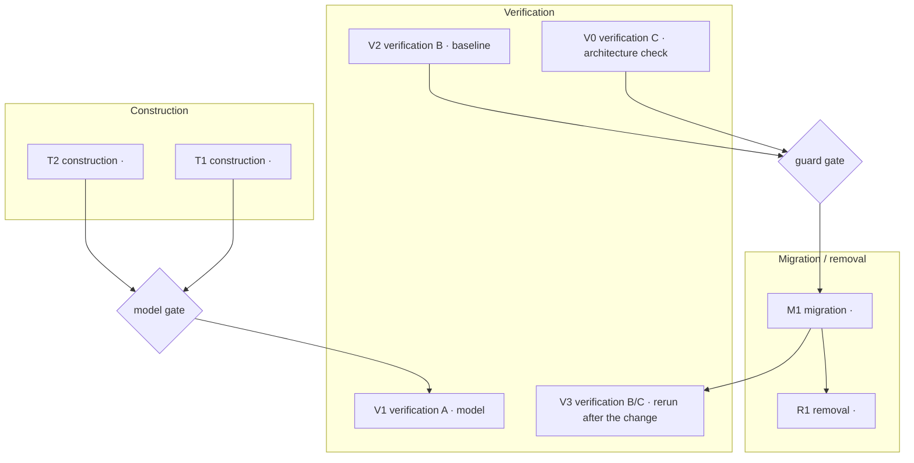

# PRD task decomposition — four classes of task

pdd:decompose cuts a PRD into four classes of task and lays out the dispatch order that converges fastest.
Each class has its own authoring rules; this file covers only splitting, classifying, ordering and
acceptance.

| Class | Definition | Deliverable | Authoring rules |
| --- | --- | --- | --- |
| **construction** | Adds an observable behaviour that did not exist | The new behaviour is usable | `references/task-construction.md` |
| **verification** | Models and falsifies; runs the same oracle before and after; or turns a structural rule into an executable check | Model, baseline, architecture check, comparison result | `references/task-verification.md` |
| **migration** | Moves production code, tests and docs without changing behaviour | The new structure is in, the old structure is gone | `references/task-migration.md` |
| **removal** | Makes production code, tests, docs, a flag or a dependency disappear | Something does not exist | `references/task-removal.md` |

One task has exactly one class. A mixture (moving files while changing behaviour, deleting code while
adding tests) splits into two tasks, because their acceptance objects differ: behaviour, equivalence,
architecture compliance, or non-existence.

Requirements come in two kinds, and the task class is derived from the requirement's kind (`pdd:plan` v2.1):

| Requirement | Acceptance object | Tasks |
| --- | --- | --- |
| **`REQ-F` functional requirement** | The behaviour becomes falsifiable once modelled | construction + verification A (modelling) |
| **`REQ-A` architectural requirement** | The code obeys §5's architecture | migration/removal + verification C (architecture check); **if the rule's deliverable is a new structure (a new shared module, a new seam), that structure is owned by a construction task, and acceptance is still answered by the C check** |

The parenthesis in the third column is the real boundary of the classification: `REQ-A` decides the
**acceptance object** (the code obeys the architecture), not the action. An architectural requirement
saying "this layer takes its facilities through one entry point only" lands as a construction task that
builds that entry point, plus a C check answering "nobody bypasses it" — the construction's purpose is
"this module exists", the C check's purpose is "every spec file goes through it". Writing that situation as
a "refactor" yields a task with no source and no retention list.

The construction column of the trace matrix can therefore hold both `T03` and `— (behaviour already
exists)`: the first is a new module, the second is "this plan only models existing behaviour". Both must be
recognisable at a glance, so do not use the same symbol for them.

Performance work goes through `REQ-A`: only a structural change produces an order-of-magnitude gain, so its
acceptance is "the metric enters its budget" plus "the structural rule that produced the improvement
holds", answered by a C-shaped check rather than by a behavioural test.

Verification therefore has three shapes: **A modelling**, **B behavioural guard (baseline → change → rerun
unchanged)** and **C architecture check (rule becomes pass/fail)**.

**There are no numeric quotas.** Task size is a judgement, not a threshold: small enough that one subagent
finishes it in one pass and, on failure, can be named as the culprit; large enough to need two seams to
describe, or to deliver two independently shippable results, means two tasks. Any "file-count cap",
"step cap" or "line cap" gets played up to as a quota, and a split produced that way costs more than a
coarse one.

## When to use

- A PRD spans several behaviours, files or subagents.
- The work needs parallel dispatch and a declared dependency order.
- The user names PDD decomposition, or asks for a task breakdown, DAG, work plan or subagent allocation.
- Handoff: a single-behaviour change one implementer can finish from the PRD alone belongs to
  `pdd:implement`.
- The cut is finished and about to be handed off: it still has to survive the scope/acceptance audit (§8)
  before `pdd:implement` may execute it.

## Preconditions

- `PRD.md` (business behaviour; `pdd:plan` v2 carries no flags, schema keys or file paths).
- Index output `<plan-dir>/TASKS.md` (from `assets/TASKS.md`), task files in `<plan-dir>/tasks/` (from
  `assets/TASK.md`).
- A task's body exists in exactly one place. Two copies drift, and the subagent follows whichever copy it
  read last.
- Nothing is frozen. A task file describes how the work lands now; when the measured repo contradicts it,
  the main agent revises the affected tasks with a dated amendment, keeps the id, and keeps going.

## Workflow

### 1. Read the PRD, classify first

Start with the requirement's kind. `REQ-F` describes behaviour, so ask "which class of action does this
need"; `REQ-A` describes structure, so ask "which structural change delivers it, and which check decides
it". One table answers both questions.

- The behaviour does not exist yet → construction
- The behaviour must become checkable → verification
- Behaviour unchanged but the structure must change → migration
- Something must disappear → removal

Read the whole document; do not summarise the detail away, because later tasks quote the original ids and
text. One `REQ` may need several classes of task (new behaviour plus deletion of the old path) — write both
into the trace matrix.

### 2. Reconnaissance (read the code, read-only)

Dispatch read-only reconnaissance subagents with `delegate_task`, one per area, each brief demanding
`file:line` evidence rather than opinion. The report covers:

- each behaviour's entry point → call chain → production seam;
- the real data owner and the state transitions (caches and mirrors included);
- existing tests and the commands that run them, and what each one pins;
- **what will be moved or deleted**: the referrer list, tests, doc passages, flags, dependencies;
- coupling, shared mutable state, ordering and atomicity, migration risk;
- files that must change, files that must not be touched, and conflicts with the PRD.

Reconnaissance is read-only: no repo edits, no commits, no build that mutates artifacts. When synthesising
the report, verify every `file:line` you quote yourself.

**Greenfield**: there is no `file:line` to quote, so the trace matrix's current-state column says `absent`
and the seam is the file or route this plan declares. Such a plan has no migration or removal tasks.

### 3. Trace matrix

One row per `REQ`:

`REQ | kind F/A | behaviour or structural rule | current state (file:line) | production seam | task classes needed`

A `REQ` with no findable seam is a PRD gap: send it back to `pdd:plan` or ask the user; never invent a seam.
A surface the product needs but no `REQ` covers goes into `AMENDMENTS.md` (conflict, evidence, ruling,
affected ids), with a `REQ` id appended at the end of that flow and the PRD and its requirement list
updated to match.

**Test facilities are surfaces too.** If the plan adds several spec files, ask first which fixture set they
share (fake transport, output channel, scratch config directory, seed). When the PRD has no requirement
covering that shared set, do not let each verification task build its own — that copies the old files'
duplication into the new ones. Write the gap into `AMENDMENTS.md`, trace a `REQ-A` ("this layer takes its
facilities through one entry point only"), and add one construction task (the new module) plus one C check.
The evidence for enabling it quotes `file:line`: where the old files' local `sink()` / fake transport
sits.

**The exception for an old rule that is "already violated today".** If the `REQ-A`'s current-state column
says "this is being violated right now" (27 zero-reference exports, 4 duplicated parsers), that check
**cannot be all green before the change**. Write the C task's two phases into the task file: phase one
accepts "the hit set equals the frozen violation list" (or "must not grow past the baseline"), phase two
accepts "empty set"; both changes to the list (creating it, emptying it) belong to the main agent, never to
the task itself.

The trace matrix is also the cross-class attribution table: when a verification task reports a divergent
transition, the seam it read names the construction task that owns it; a divergence on a `REQ-A` names the
modules inside its scope, not some seam.

A `REQ-A` with no seam is normal: it quantifies structure. Its current-state column says which rule is
violated today (or that it holds today and must be maintained), not a list of file paths.

### 4. Split, then classify

Split per `references/task-splitting.md`. Each unit is classified at the moment it is cut, on the evidence
of the files it owns and the thing it changes, not on its motive:

- changes production code → construction (`REQ-F`, behaviour changes) or migration (`REQ-A`, behaviour
  unchanged)
- turns a structural rule into an executable judgement → verification C
- owns only a model, harness or pin → verification
- only makes things disappear, plus rewriting the references → removal

### 5. Write the task files

Each `tasks/<id>-<slug>.md` opens with a header table: task id, class, the requirement it serves (`REQ-F`
or `REQ-A`), dependencies, owned-file list — so the subagent can confirm at a glance that it opened the
right file. Zero-pad the numbers so lexicographic order equals dispatch order.

Apply the matching authoring file per class (`task-construction` / `task-verification` / `task-migration` /
`task-removal`): that file states which fields the class requires, which steps it takes, and what it
reports.

A task file must not contain tests, models, baselines or constraint scripts — those are the verification
task's owned files.

### 6. Draw the DAG (class on the node, two kinds of gate)

One mermaid `flowchart TD`: one node per task, the class in the node label; `Depends on` becomes an edge;
siblings in the same layer with no edge between them run in parallel. No cycles, no orphans, no edges
without a task.

A gate node has no owner and no files; it draws the ordering rule into the graph so a reader cannot miss
it. Derive the waves: `depth(n) = 1 + max(depth(parents))`, roots in wave 1; recompute after every edge
change.

**The register's dependency column writes every id out.** A range like `V02`–`V06` is ambiguous to readers
and to programs alike (a parser sees two ids), and the register and the DAG must be equal task by task —
write all five ids so a program can compare them. Reconciliation method: parse the DAG's edges into parent
sets, parse the register's dependency column into id sets, compare task by task, and recompute the waves
from the edges to check them against the hand-written wave table.

### 7. Dispatch

**Construction, migration and removal run on subagents**, and the main agent accepts a report only after
checking it against the purpose, the owned files and the acceptance object. A subagent's self-reported
success is not acceptance.

**Verification dispatches by gate**:

- **model gate**: A-class verification is dispatched only after every construction task it covers has been
  accepted.
- **guard gate**: two things must be in place before the change — the B-class behavioural baseline has run
  and is frozen (read-only), and the C-class architecture check exists and is all green. After the change
  both rerun with the same command: behaviour compared bit for bit, architecture check still passing.
- **The C-class check table is owned by the verification task, not by the migration task.** A migration
  task that needs to edit a check currently judging it is granting itself an exemption: that needs a dated
  amendment first, ruled on by the main agent.

**Defect routing**: a verification agent that finds a production defect does not fix it — it reports the
trace and the seed, and the main agent opens a construction or migration task; that task re-enters the
production side, and the gate closes again on the affected flows.

### 8. Audit the cut (one auditor per three tasks)

A cut reads plausibly and still fails on contact: a scope that is not minimal, an acceptance criterion
nobody can decide, two tasks owning one file. Its author cannot see that, because the cut was written out
of the same understanding that produced the error. So the finished cut is audited by fresh readers before
handoff, and the audit costs a fraction of one wrongly dispatched task.

**Grouping is one subagent per three tasks**: with `n = |register|`, that is `ceil(n/3)` auditors, the
register partitioned into contiguous groups in dispatch order (wave by wave, id ascending), at most three
tasks each. Contiguous grouping keeps both sides of a seam in front of the same reader; at every group boundary
the auditor also reads the neighbouring task files (read only) and reports a defect if the seam across the
boundary is wrong. Four tasks in one group is not a group — split it and dispatch a fourth auditor.

**The auditor is read-only and cannot rewrite the plan.** Its brief hands it paths (`PRD.md`, `TASKS.md`,
the `tasks/` directory, its own slice of ids, the class authoring files) and asks three questions per task:

- **scope** — one purpose? is the owned set minimal and sufficient, every file serving that purpose, and no
  file also owned by a sibling? does the class match the action the file describes (a move written as
  "create a module" is a construction task pretending to be a migration)?
- **acceptance** — is the criterion the one its class demands, and is it decidable by a command the task
  names? construction: an observable purpose reachable from the real entry point. A: a model plus a
  falsifiable property within a stated budget. B: a baseline frozen before the change, rerun bit for bit.
  C: all green before and after, plus a deliberate red. migration: an oracle and a retention list. removal:
  an absence proof with zero references.
- **boundary** — are the declared dependencies sufficient and pointing the right way? is a shared file owned
  by nobody or by two people? does one seam straddle two tasks, so that neither can be accepted alone?

Brief, grouping arithmetic and the finding table are in `references/scope-audit.md`. A slice with no finding
reports "three tasks read, zero findings" — never a summary of the plan, and never silence.

**An audit is a report, not a rewrite.** A finding names the task id, the clause it violates, the evidence
(the quoted sentence, or `file:line` in the repo), and the smallest fix. An auditor with write access
re-cuts the plan to its own taste, and the ids every other piece of evidence is indexed by move with it.

**The main agent reproduces every finding before acting on it** — opens the file, checks the clause,
confirms the claim. Subagent reports are not acceptance here either. An adopted finding lands as a dated
amendment on that task, id kept, with the DAG, register and waves refreshed; a finding that does not
reproduce is rejected with the reason recorded, not quietly dropped. Tasks changed by an amendment are
re-audited; the rest are not. A cut with no findings is a normal outcome of this step, and a cut with
findings that all get adopted is the reason the step exists.

### 9. Review, then hand off

No document-verification script exists, and none is added. A linter can only check presence — the id has a
field, the heading exists — while "is this sentence true and useful" cannot be checked mechanically; score
the checkable half and the author optimises only that half.

Checks (read by the main agent):

- [ ] every task has a single purpose, and its class matches its file contents (construction has no checks,
      verification has no production files, migration has an oracle, removal has an absence proof);
- [ ] every task's owned set is the minimal sufficient set for that work, and every file has exactly one
      writer;
- [ ] every migration names its oracle and its retention list;
- [ ] every removal names its replacement and the evidence that references reached zero, and its tests die
      with it;
- [ ] every flow has exactly one model and one harness entry;
- [ ] every `REQ-A` has a C-class verification task holding its check, and that check was all green before
      the migration;
- [ ] no task changes both a structure and the check that judges it;
- [ ] the DAG has no cycles, no orphans and no ownerless gates, and both the model gate and the guard gate
      (behavioural baseline + architecture check) are drawn;
- [ ] every surface the plan claims to deliver is produced by some construction task's purpose or owned
      files;
- [ ] every task was read by an auditor that did not write it, `ceil(n/3)` auditors covered the whole
      register, every seam boundary fell inside some auditor's slice, and each finding is either adopted by
      a dated amendment or rejected with its reason recorded;
- [ ] reading one task file alone is enough to start work.

## Decision rules

### Class combinations (ordering)

| Must come first | Then | Reason |
| --- | --- | --- |
| construction (new flow commands) | verification A | the model describes code that already exists |
| verification B (run the baseline) | migration | no baseline, no equivalence |
| verification C (architecture check all green) | migration | no criterion, no termination condition and nothing to refuse |
| migration | verification B/C (rerun) | behaviour compared bit for bit; architecture check must still pass |
| construction (the replacement) plus its verification coverage | removal (of the old thing) | without a replacement it is not a deletion, it is unfinished work |
| migration | removal (old path) | clean up only after the move |
| removal | constraint checks (dependency graph, export surface, links) | after deleting, prove no hole was left |

Forbidden combinations:

- verification A and migration running in parallel on the same flow — the model gets polluted by a change
  in flight;
- two verification tasks co-editing one model;
- one task both moving structure and changing behaviour;
- a migration with no oracle, a removal with no replacement, a rerun with no baseline;
- a migration task editing the architecture check that judges it (self-exemption);
- a construction task depending on its own verification (a cycle).

### Efficiency (how to combine for the fastest convergence)

- **Delete rather than refactor, refactor rather than rewrite.** Every extra kind of action adds an oracle
  and a rollback path.
- **Verification is counted per flow, not per task.** Three construction tasks serving one flow get one
  verification task.
- **Slice migrations and run unrelated construction in parallel**; but a flow's migration does not run in
  parallel with its verification.
- **Ship the replacement and delete the old thing together**, in the same batch, so the coexistence period
  does not become permanent.
- **With no oracle, spend one verification task buying the oracle first, then migrate.** That is usually
  cheaper than the migration itself.
- **A removal carries its tests in the same task**, leaving no orphan assertions (measured: about 91.4% of
  deleted tests were stale tests whose production code had already gone).

### Splitting

`references/task-splitting.md` holds the normative splitting criteria (attributability, coupling
exceptions, split signals, coherence, probing the edges, ownership summary). This file does not restate
them: a rule written in two places drifts, and the reader follows whichever copy it read last.

## Re-decomposing a plan already in flight

A plan whose principles changed, or whose implementation is stuck on a structural contradiction, is
reconciled rather than re-cut. Load this skill and its templates, pause the writers, and preserve three
things: the current source tree, the evidence for accepted tasks, and the plan as it stands.

Check every unfinished task against the current tree and classify it as accepted, implemented but not
accepted, still to do, or superseded by a named successor. A partial pass is not acceptance of the original
scope; a partially implemented seam is not work to rebuild from zero. Write an explicit old-task → new-task
disposition table, carry every unmet requirement and boundary across, and verify the incoming and outgoing
path sets with code so that genuinely new prerequisites separate out from omissions. Point a designated
replacement index or supersession pointer at the new plan, do not renumber accepted history, and resume
implementation once the new DAG has both gates drawn. Do not restart verification batches that already ran:
the flows they modelled are re-pointed at the new task ids, and only flows whose seam actually moved are
remodelled.

## Pitfalls

- **Every task becomes construction.** A move written as "create a new module", a deletion written as
  "create a cleanup script", and the old thing stays forever → classify by action, not by addition.
- **A migration starts with no oracle.** Afterwards all anyone can say is "it looks the same" → dispatch
  one verification task to buy the oracle first.
- **A removal starts with no replacement.** The user loses the old thing before having the new one → build
  first, delete second.
- **One task spans two classes.** The acceptance objects conflict (behaviour vs equivalence vs
  non-existence) and failure cannot be attributed → split.
- **Two verification tasks on one flow.** Two models overwrite each other and both believe they are green →
  one model per flow.
- **A verification agent edits production files along the way.** The discovery disappears into an
  unreviewed diff and the class boundary goes with it → report the trace, let the main agent open the task.
- **An architectural requirement accepted as "behaviour unchanged".** That is only a guard, not an
  acceptance criterion; without a C check the migration has no termination condition and nothing to refuse.
- **A migration loosens the constraint along the way.** Once the check is loosened the migration is
  "compliant" by construction → editing a rule that judges you requires an amendment first.
- **A performance requirement with no baseline.** No before means no after to attribute; only "some
  optimisation was done" remains.
- **Numeric quotas treated as the criterion.** Splitting to hit a file count or a step count leaves two
  halves sharing one seam → size is a judgement; if you cannot name the coupling, do not split.
- **The plan claims a surface nobody builds.** The PRD lists a screen and the task set never touches it →
  before dispatch, sweep the PRD's surface list against every construction purpose.
- **Several new spec files, zero shared fixtures.** Six verification tasks each declare their own `sink()` /
  fake transport, and six different understandings of "what a request recorded" → trace a `REQ-A` and add a
  construction task (the test-bench module) so all six take their samples through it. Existing convergence
  gates cannot catch this: their marker lists are finite enumerations, and a newly invented set of names is
  not on them.
- **An architecture check written as "all green before the change" for a rule that is already violated
  today.** The guard gate can never close from day one, so either someone relaxes the check or the whole
  batch stalls → make it two phases (freeze the violation list → empty set) and give the list's upkeep to
  the main agent.
- **Artifacts landing where a gate enumerates them.** A new check script and a frozen baseline
  (transcript, duration, violation list) dropped into a directory that has an existing count or list
  pinning it means touching a contract that is not yours → before landing, run
  `grep -rn 'readdir' <the scanning side>` to find which directories are enumerated and which are not; a
  directory nobody enumerates is where the new artifact belongs.
- **The cut audited by its author.** The person who wrote the split reads it back as confirmation, finds
  the wording satisfying and the seams intended → a fresh auditor per three tasks, reading the PRD first and
  the task file second, with the acceptance criterion of the class in hand.
- **An auditor handed write access.** It re-cuts the plan to its own taste, every id the register, the DAG
  and the trace matrix are indexed by moves, and the audit's findings and the rewrite become
  indistinguishable → the auditor reports; the main agent amends.
- **Findings adopted without reproduction.** "The acceptance criterion looks vague" arrives ten times a run,
  half of them wrong, and each one silently widens a task → reproduce it, or reject it in writing with the
  reason.
- **`floor(n/3)` auditors for `n` tasks.** The remainder is a task nobody audited, and the report says the
  audit is complete → `ceil`, and check the number of covered ids against the register before acting.

## Verification

- [ ] `TASKS.md` holds exactly one mermaid DAG, with class labels and both gates; the register has one line
      per task recording its class; every node has a task file.
- [ ] Task bodies are not duplicated between `TASKS.md` and `tasks/`.
- [ ] The register's dependency column equals the DAG's edges; waves are derived from depth.
- [ ] `REQ` traceability is complete in both directions, and each row's seam names the construction task
      that owns it.
- [ ] No task file carries tests, models, baselines or constraint scripts (those belong to verification
      tasks).
- [ ] Every migration has an oracle and a retention list; every removal has a replacement and evidence that
      references reached zero.
- [ ] No numeric quota was used as a splitting criterion; any unit beyond "needs two seams to describe" has
      been split or has its coupling written down.
- [ ] Every comparison-based criterion names one perturbation that must make it red — B's baseline comparison
      as much as C's injected violation.
- [ ] Every multi-step task declares its checkpoints; no task, migration or otherwise, describes a
      "rollback point" instead of a step to resume from.
- [ ] Every task file states what would make its acceptance fail, not only what the command produces; a
      criterion satisfied by an artefact existing is sent back.

> Cross-skill references name the sibling skill and the file separately:
> `skill_view("pdd:decompose", "references/task-construction.md")`. Every sibling is registered under
> this plugin's namespace, so the skill argument always carries the `pdd:` prefix and the path is
> relative to that skill's own directory.

## References

- `assets/TASKS.md` — index template: two-gate DAG with classes, register, trace, dispatch.
- `assets/TASK.md` — task template: field shapes and report format for the four classes.
- `references/task-construction.md` — construction: a new observable behaviour.
- `references/task-verification.md` — verification: modelling (A) and guarding (B).
- `references/task-migration.md` — migration: moving production code, tests, docs.
- `references/task-removal.md` — removal: delivering a non-existence.
- `references/scope-audit.md` — the pre-handoff audit: grouping arithmetic, the read-only brief, the three
  questions per task, the finding table, and what the main agent does with a finding.
- `references/task-splitting.md` — normative splitting criteria: attributability, coupling exceptions,
  signals, coherence, probing the edges, ownership.
- `references/testing-methodology.md` — the testing regime: flow as the unit, PBT, budgets, negative
  controls, where the method breaks. The only place testing is specified.
- `references/atomic-task.md` — worked examples of splitting, shapes that must not be split, fragmentation
  counters.
- `references/ownership-rules.md` — one writer per file, with the four classes' boundaries and the
  test-deletion rule.
- `references/pitfalls.md` — the full catalogue; the testing-related entries there are historical.
