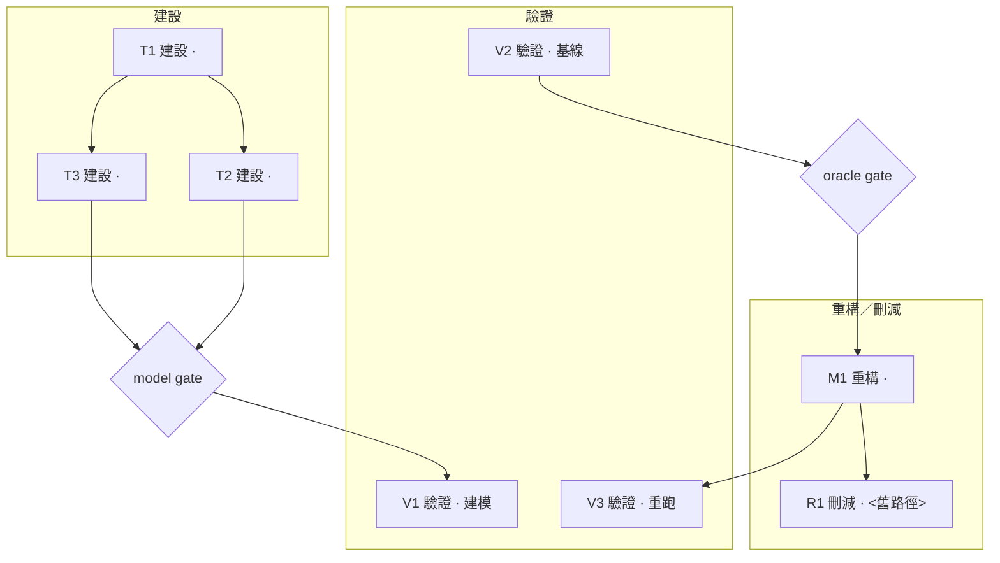

# TASKS — <slug>

| Field | Value |
| --- | --- |
| PRD | `<path/to/PRD.md>` |
| Date | <YYYY-MM-DD> |
| Status | 工作契約 |
| Workflow | 四類任務 → model gate／oracle gate → 派遣 |
| Task files | `tasks/<id>-<slug>.md`，一件一檔 |

`TASKS.md` 是**索引層**：含類別的 DAG、任務 register、需求追蹤、gate 與派遣順序。每件任務的正文在 `tasks/` 下自己的檔案裡，那是 subagent 唯一需要讀的東西。每個檔案一個 writer。

沒有凍結。任務檔描述它現在如何落地；量到的 repo 與它矛盾時，main agent 修改受影響的任務、保留 id、繼續。PRD 保有它自己的文字，以 dated 決策變更。

**沒有數值配額。** 大小是判斷：一件任務小到一個 subagent 一次做完、失敗能指名它；大到需要兩個 seam 才說得清就是兩件。任何檔數、步數、行數上限都會被當成配額去湊。

## 1. 類別清單

| Class | 件數 | 涵蓋的 flow／路徑 |
| --- | --- | --- |
| construction | <n> | <flow 清單>（對應 `REQ-F`） |
| verification | <n> | <flow ｜ 基線 ｜ 重跑> |
| migration | <n> | <source → target>（對應 `REQ-A`，含效能） |
| removal | <n> | <消失的東西>（功能退役或架構收斂） |

## 2. DAG

邊 `A --> B` 表示 **B 依賴 A**，A 被接受後 B 才可開始。gate 節點沒有 owner、沒有檔案；它把時序規則畫進圖裡。同層無邊者平行。

派生波次：`depth(n) = 1 + max(depth(parents))`，根在第 1 波；每次改邊重算。手寫的波次清單第一次改邊就與圖矛盾。指出關鍵路徑與長度，讓擁有者看見是哪條鏈在約束排程。

## 3. Task register

| Task | Class | Title | Depends on | Files owned | REQs | Seam / Flow | File |
| --- | --- | --- | --- | --- | --- | --- | --- |
| `T1` | construction | <title> | — | `<path>` | `REQ-...` | `<file:function>` | [`tasks/T1-<slug>.md`](tasks/T1-<slug>.md) |
| `V1` | verification | <flow model> | `G1` | `<model>`, `<harness>`, `<pin>` | `REQ-...` | `<flow>` | [`tasks/V1-<slug>.md`](tasks/V1-<slug>.md) |
| `M1` | migration | <source → target> | `G2` | `<src>`, `<dst>` | `REQ-...` | `<file>` | [`tasks/M1-<slug>.md`](tasks/M1-<slug>.md) |
| `R1` | removal | <舊路徑> | `M1` | `<deleted>`, `<callers>` | `REQ-...` | `<file>` | [`tasks/R1-<slug>.md`](tasks/R1-<slug>.md) |

## 4. 任務檔

一件任務一個檔，檔名以類別前綴辨識（`T` 建設、`V` 驗證、`M` 重構、`R` 刪減），補零使字典序等於派遣序。每個檔自足：類別、purpose、依賴、一個 seam 或一個 flow、owned 集合、有序步驟、報告格式。

不在這裡重述任務正文。第二份會漂移，subagent 跟隨它最後讀到的那份。

## 5. 需求追蹤

| REQ | 類別 | 建設任務 | Seam | 驗證任務 | 重構／刪減 |
| --- | --- | --- | --- | --- | --- |
| `REQ-F-...` | 功能 | `T1` | `<file:function>` | `V1`（建模） | `—` |
| `REQ-A-...` | 架構 | `—` | <它量化的模組範圍> | `V0`（架構檢查） | `M1` / `R1` |

每個 PRD 需求至少出現一次。功能需求的驗證任務是建模（A）；架構需求的驗證任務是架構檢查（C），它的「seam」欄寫模組範圍而不是入口點，因為它量化的是結構。

沒有驗證任務的功能需求是沒人建模的 flow；沒有 C 類任務的架構需求是沒人判定的願望——兩者都寫成刻意的缺口並附理由，不要留白。

## 6. Gate 與派遣

**model gate（`G1`）**：它所覆蓋的建設任務全部被接受後，驗證 A 類才開始。接受不是自報成功：main agent 讀報告，對 purpose 與 owned 檔案核對，並把 PRD 的表面清單再掃一遍。

**oracle gate（`G2`）**：基線必須在重構／刪減**之前**跑完並凍結（只讀）。改動後用同一命令、同一 artifact 重跑，逐位比較；差異即語意漂移。

派遣只在每個依賴都被 main agent 接受時發生，不是 subagent 回報成功時。

## 7. 耦合例外

| Task | 為什麼不是一個單位 | 補償 |
| --- | --- | --- |
| — | none | 切分符合規範 |

例外只為可指認的耦合存在：與它一起生成的產物、repo 的層級門檻、單一 seam 的成功與拒絕、harness 只從那個檔收集 fixture。它從不合併兩個可獨立上線的行為，也從不為了湊一個數字。

## 8. Review checklist

- [ ] 每個 PRD 需求都被覆蓋，且每件任務都追到 `REQ-F` 或 `REQ-A`；
- [ ] 每條 `REQ-A` 都有一件 C 類驗證任務，且該檢查在重構之前已全綠；
- [ ] 每件任務的類別與其檔案內容一致（建設無檢查、驗證無生產檔、重構有 oracle、刪減有 absence proof）；
- [ ] 每個檔案只有一個 writer；共享檔以宣告的依賴序列化；
- [ ] 每件重構都指得出 oracle 與保留清單；每件刪減都指得出替代品與零引用證據；
- [ ] 每個 flow 只有一個模型檔與一個 harness 入口；
- [ ] DAG 無環、兩個 cluster 都在、每個驗證與重構節點都掛在對應 gate 下；
- [ ] register 的依賴欄等於 DAG 的邊；波次由深度算出並覆蓋所有任務；
- [ ] 沒有任務檔攜帶測試、模型、基線或約束腳本；
- [ ] 沒有任何數值配額被當成切分標準；
- [ ] 只讀一件任務檔就能動工。
