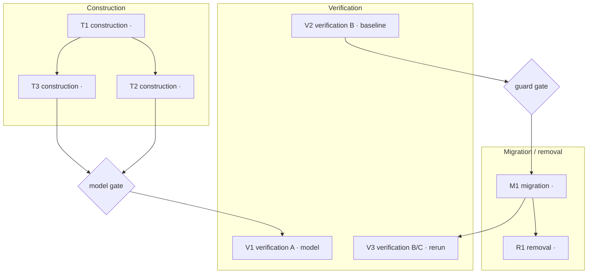

# TASKS — <slug>

| Field | Value |
| --- | --- |
| PRD | `<path/to/PRD.md>` |
| Date | <YYYY-MM-DD> |
| Status | working contract |
| Workflow | four classes → model gate / guard gate → dispatch |
| Task files | `tasks/<id>-<slug>.md`, one file per task |
| Scope audit | `<auditors> auditors over <n> tasks; findings <k>, adopted <a>, rejected <r>` |

`TASKS.md` is the **index layer**: the DAG with classes, the task register, requirement traces, the gates and
the dispatch order. Each task's body lives in its own file under `tasks/`, which is the only thing a subagent
needs to read. One writer per file.

Nothing is frozen. A task file describes how the work lands now; when the measured repo contradicts it, the
main agent revises the affected task, keeps the id and keeps going. The PRD keeps its own text and changes by
dated decision.

**There are no numeric quotas.** Size is a judgement: a task small enough that one subagent finishes it in one
pass and, on failure, can be named as the culprit; large enough to need two seams to describe, or to deliver
two independently shippable results, is two tasks. Any file cap, step cap or line cap gets played up to as a
quota.

## 1. Class register

| Class | Count | Flow / path covered |
| --- | --- | --- |
| construction | <n> | <flow list> (`REQ-F`) |
| verification | <n> | <flow, baseline, rerun, architecture check> |
| migration | <n> | <source → target> (`REQ-A`, performance included) |
| removal | <n> | <what disappears> (feature retirement or architectural convergence) |

## 2. DAG

An edge `A --> B` means **B depends on A**: B starts only after A is accepted. A gate node has no owner and
no files; it draws the ordering rule into the graph. Siblings with no edge between them run in parallel.

Derive the waves: `depth(n) = 1 + max(depth(parents))`, roots in wave 1; recompute after every edge change. A
hand-written wave list contradicts the graph at the first edge change. Name the critical path and its length,
so the owner can see which chain is constraining the schedule.

## 3. Task register

| Task | Class | Title | Depends on | Files owned | REQs | Seam / flow | File |
| --- | --- | --- | --- | --- | --- | --- | --- |
| `T1` | construction | <title> | — | `<path>` | `REQ-...` | `<file:function>` | [`tasks/T1-<slug>.md`](tasks/T1-<slug>.md) |
| `V1` | verification | <flow model> | `G1` | `<model>`, `<harness>`, `<pin>` | `REQ-...` | `<flow>` | [`tasks/V1-<slug>.md`](tasks/V1-<slug>.md) |
| `M1` | migration | <source → target> | `G2` | `<src>`, `<dst>` | `REQ-...` | `<file>` | [`tasks/M1-<slug>.md`](tasks/M1-<slug>.md) |
| `R1` | removal | <old path> | `M1` | `<deleted>`, `<callers>` | `REQ-...` | `<file>` | [`tasks/R1-<slug>.md`](tasks/R1-<slug>.md) |

Write every dependency id out. A range such as `V02`–`V06` is ambiguous to readers and to programs (a parser
sees two ids), and the register must equal the DAG task by task.

## 4. Task files

One file per task, the filename prefixed by class (`T` construction, `V` verification, `M` migration,
`R` removal), zero-padded so lexicographic order equals dispatch order. Each file is self-sufficient: class,
purpose, dependencies, one seam or one flow, the owned set, ordered steps, report format.

The task body is not restated here. A second copy drifts, and the subagent follows whichever copy it read
last.

## 5. Requirement trace

| REQ | Kind | Construction task | Seam | Verification task | Migration / removal |
| --- | --- | --- | --- | --- | --- |
| `REQ-F-...` | functional | `T1` | `<file:function>` | `V1` (modelling) | `—` |
| `REQ-A-...` | architectural | `—` | <the module range it quantifies> | `V0` (architecture check) | `M1` / `R1` |

Every PRD requirement appears at least once. A functional requirement is verified by modelling (A); an
architectural requirement is verified by an architecture check (C), whose seam column names a module range
rather than an entry point, because what it quantifies is structure.

A functional requirement with no verification task is a flow nobody models; an architectural requirement with
no C task is a wish nobody decides. Write both as deliberate gaps with the reason, never as a blank cell.

## 6. Gates and dispatch

**model gate (`G1`)**: A-class verification starts only after every construction task it covers has been
accepted. Acceptance is not a self-report: the main agent reads the report, checks it against the purpose and
the owned files, and sweeps the PRD's surface list once more.

**guard gate (`G2`)**: before migration or removal, two things must be in place — the B-class behavioural
baseline has been recorded and frozen (read only), and the C-class architecture check exists and is all
green. After the change both rerun with the same command and the same artifact; behaviour is compared bit for
bit, and the architecture check must still pass.

Dispatch happens only when every dependency has been accepted by the main agent, never when a subagent
reported success.

## 7. Coupling exceptions

| Task | Why it is not one unit | Compensation |
| --- | --- | --- |
| — | none | the cut follows the rules |

An exception exists only for an identifiable coupling: an artefact generated together with its source, a
repo's layering threshold, one seam's success and rejection being inseparable, a harness collecting its
fixtures from that one file. It never merges two independently shippable behaviours, and it never exists to
hit a number.

## 8. Scope audit (before handoff)

| Auditor | Tasks audited | Neighbours read | Findings | Adopted | Rejected |
| --- | --- | --- | --- | --- | --- |
| `A1` | `T1` `T2` `V1` | `V0` | 1 (`T2`) | 1 | 0 |
| `A2` | `V0` `M1` `R1` | `V1` | 0 | — | — |

`ceil(n/3)` auditors, contiguous slices in dispatch order, at most three tasks each; the union of slices must
equal the register. Brief, questions and finding table: `references/scope-audit.md`.

A finding is closed only by a disposition: adopted as a dated amendment on that task (id kept, DAG, register
and waves refreshed), or rejected with the reason recorded. Amended tasks are re-audited; untouched tasks are
not. A cut with zero findings is reported as such, not left blank.

## 9. Review checklist

- [ ] every PRD requirement is covered, and every task traces to `REQ-F` or `REQ-A`;
- [ ] every `REQ-A` has a C-class verification task, and that check is all green before the migration lands;
- [ ] every task's class matches its file contents (construction has no checks, verification has no
      production files, migration has an oracle, removal has an absence proof);
- [ ] every file has exactly one writer; shared files are serialised by a declared dependency;
- [ ] every migration names an oracle and a retention list; every removal names a replacement and the
      evidence that references reached zero;
- [ ] every flow has exactly one model file and one harness entry;
- [ ] the DAG has no cycles, both clusters are drawn, and every verification and migration node hangs under
      its gate;
- [ ] the register's dependency column equals the DAG's edges; the waves are derived from depth and cover
      every task;
- [ ] no task file carries tests, models, baselines or constraint scripts;
- [ ] no numeric quota was used as a splitting criterion;
- [ ] `ceil(n/3)` auditors covered every task, every seam boundary fell inside some auditor's slice, and every
      finding has a disposition;
- [ ] reading one task file alone is enough to start work.
