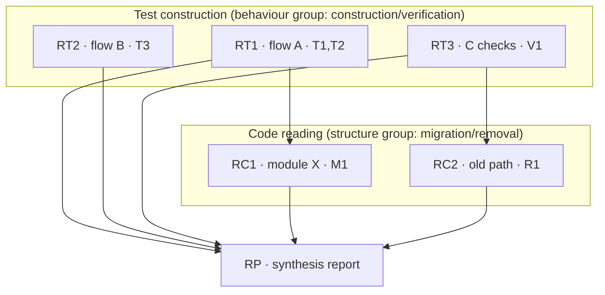

# PRD review

Four steps: **the main agent reads the PRD and every task file → writes a review DAG → dispatches two kinds
of reviewer along that DAG → synthesises the findings into one report.**

There are only two kinds of reviewer, with different powers and one normative file each: the
**test-construction** reviewer may touch tests (strengthen existing assertions first, add counterexamples
second) and reviews behaviour that has an objective acceptance criterion; the **code-reading** reviewer only
reads, and reviews architecture, migration, removal and subjective judgements.

| File | For whom |
| --- | --- |
| `references/subagent-invocation.md` | the main agent: how to dispatch (which two paths are mandatory) |
| `references/reviewer-test-construction.md` | the test-construction reviewer |
| `references/reviewer-code-reading.md` | the code-reading reviewer |
| `references/finding-schema.md` | both: finding fields, the two axes' evidence requirements, adversarial lists, architecture lists |

Review fixes no code and edits no plan. Once findings are handed over, `pdd-decompose` opens them as new
tasks and `pdd-implement` dispatches them.

## When to use

- The user asks for a review, or an implementation claims completion and needs an independent verdict.
- The change crosses module boundaries, and the existing tests each cover only their own half.
- There are `REQ-A`s (architectural requirements), and the question is whether the code really obeys the
  declared architecture.
- Routing: `pdd-plan` writes the plan, `pdd-decompose` cuts tasks, `pdd-implement` executes, `pdd-explain`
  explains it to a non-engineer.

## Preconditions

- **The main agent reads everything**: `PRD.md`, `TASKS.md`, and **every** `tasks/*.md`. Reading only the
  in-scope task files makes the scope partition a guess and misses cross-task contract conflicts.
- **A target**: branch, commit range, diff, or an explicit module list, extended to the production entry
  points and to the callers of every changed surface.
- **Evidence in place**: the flow's model and pins (A), the baseline and the rerun comparison (B), the
  architecture check and the injected-violation record (C). A missing item is "unverified" — record it
  before reading any code.
- **Reviewers receive no hypotheses**: the brief gives paths and the questions to answer, never "I suspect a
  bug here".

## Workflow

### 1. Read the PRD and every task file

Build this table as you read; it is the only basis for cutting scope:

| Task | Class | owned files | `REQ` | where the existing oracle lives |
| --- | --- | --- | --- | --- |

The table shows directly which tasks have objective acceptance (a `REQ-F` flow, verification A/B/C) and
which do not (`REQ-A`, a migration's structural choices, tidying work).

### 2. Write a review DAG

**Scope cap: at most 3 tasks per review agent.** Not a quota but a ceiling: findings must be attributable to
a specific task, and 3 tasks' owned sets still fit in one subagent's context. Beyond that, split the unit —
never compress the brief.

**Two hard partitioning rules**:

1. **The `Class`es inside one unit must belong to the same group.** The four classes form two groups: the
   **behaviour group** (`construction`, `verification`) and the **structure group** (`migration`,
   `removal`). A mixed group must be split — not given to one reviewer to cover both sides.
2. Only after that comes the cutting method: the behaviour group is cut by flow (a flow's construction and
   its verification share a unit, because they describe the same behaviours); the structure group is cut by
   module (the scope a `REQ-A` quantifies over is the natural boundary).

**Reviewer type is a function of `Class`, not a judgement**:

| Task `Class` | Reviewer | What it reviews |
| --- | --- | --- |
| `construction` | **test construction** | behaviour: whether existing assertions are hollow, counterexamples, boundaries, state transitions |
| `verification` (A/B/C) | **test construction** | the check itself: model coverage, bit-comparable baseline, whether the C check bites |
| `migration` | **code reading** | retention list, source→target, old paths, coexistence and deprecation |
| `removal` | **code reading** | absence proof, the tests that die with it, residue |

**Look at `Class`, not at the `REQ` kind.** When a `REQ-A` is delivered by a verification C task, the
reviewer of that task is test-construction — whether that C check bites is one `mutate_check` command away.
Code-reading reviews only the parts with no objective standard: a migration's structural choices, a
removal's residue, architecture declarations with no check, naming and structure.

**There is no default type.** A missing or vague `Class`, or a task that looks like it belongs to both
classes, is a plan defect: stop and report, do not pick the more convenient type. **Dispatching
code-reading every time is the most common degradation** — it strips counterexamples from every behavioural
task, and counterexamples are the main value of a review.

**Dependencies (only those with a nameable mechanism)**:

- the same file in two scopes → serialise (one writes tests, the other only reads).
- a migration/removal unit depends on the test-construction unit of the flow it protects: the equivalence
  evidence must be in place first.
- code-reading units have no dependencies between them and can all run in parallel.
- fan-in: the report node depends on every unit.

Write one card per unit: unit id, reviewer type, the scope's task ids, the questions to answer (3–6, each
decidable), and the output format.

### 3. Dispatch along the DAG

Dispatch rules are in `references/subagent-invocation.md`. The most important one: **every brief carries two
paths** —

1. **the task directory** `<plan-dir>/tasks/` (this unit's task files are in it, read-only);
2. **the normative file for that reviewer type**, `reviewer-test-construction.md` or
   `reviewer-code-reading.md`.

Plus the base charter `pdd-implement/references/subagent-charter.md` (compile scope, naming, report format).
All three are paths, not pasted text — pasting full text rewrites the contract at dispatch time.

One subagent per unit; dispatch the batch and end the turn without polling; when the parallelism ceiling is
short, use waves, but wave order obeys the DAG's partial order.

### 4. Synthesise the findings

1. **Each finding passes through you once.** Test findings: rerun the command and confirm the red leg and the
   green leg. Code-reading findings: point to the specific line and the clause it violates — for a subjective
   finding, "reproduction" means identification, not execution.
2. **Deduplicate by root cause**, not by number of symptoms. Two units reporting the same thing merge, with
   both sides' evidence kept.
3. **Split by axis**: a functional axis and an architectural axis, each its own section, each judged
   separately, never collapsed into one score.
4. **Plan defects get their own section**: a `REQ-A` with no C check, a flow with no model, one `REQ`
   spanning two flows, a migration with no oracle, a removal with no absence proof, a task whose class does
   not match its contents.
5. **List `unproven` separately from proven.**

## Decision rules

### Verdicts

| Axis | Verdict | Condition |
| --- | --- | --- |
| Functional | pass | every in-scope flow has a model, covers the changed seams, and no counterexample reproduces |
| | pass with findings | counterexamples or hollow properties exist, at acceptable severity |
| | fail | one counterexample breaks some `REQ-F` |
| Architectural | pass | every `REQ-A` has a C check, the check bites, the code obeys |
| | pass with findings | the check exists and bites, but there are local violations or uncovered scope |
| | fail | a `REQ-A` has no check, or the code violates the rule it declares |

The whole is not an average: any axis failing means the whole fails.

### Report format

1. The two axis verdicts, each with a one-sentence reason.
2. Proven findings, ordered by severity: id, axis, task, `file:line`, expected vs actual (or the violated
   clause), minimal input, command, evidence location.
3. `unproven` risks, each with "what it would take to prove it".
4. Plan defects.
5. Unreviewed scope and why — no model, no oracle, tasks excluded by the 3-task cap.

### Repair is out of scope

**Repair is not part of a review.** Once the report is handed over, findings go through `pdd-decompose` to
become new tasks, dispatched in order by `pdd-implement`; review dispatches no fixer, changes no code and
edits no plan.

## Pitfalls

- **Reviewing only the diff.** Defects live in callers, shared state and lifetimes; follow the production call
  chain and read the other side.
- **Treating the PRD as complete.** It may miss a refusal, a transition, a boundary; finding the missing one
  is the review's job.
- **Letting a code-reading reviewer write tests, or a test-construction reviewer edit production code.** The
  two sets of powers are the whole of this process; cross the line once and both the evidence and the
  attribution fail.
- **A brief that pastes the task files but not the type's normative file.** The reviewer applies its own
  criteria and the two reports cannot be compared.
- **A hypothesis written into the brief.** The review becomes confirmation bias.
- **Scope above 3 tasks, or one unit mixing both reviewer types.** Findings cannot be attributed.
- **Dispatching code-reading every time.** When unsure, sending a read-only reviewer gives up
  counterexamples: a behavioural task comes back with a "looks reasonable" opinion instead of a test that
  goes red.
- **One unit mixing classes from different groups (construction with migration, say).** The reviewer is
  forced to cover two acceptance objects with one set of criteria and reviews neither deeply.
- **An architectural violation written as a review note.** It is a violation of a `REQ-A`, so it is a
  finding.
- **A new test with no owner.** A test attached to no flow or `REQ-F` has nobody to maintain it next round
  and nobody willing to delete it.
- **A report with conclusions but no evidence.** Every finding must be rerunnable by someone else with the
  command you pasted, or point to that `file:line` and clause.

## Verification

- [ ] the main agent read the PRD and every task file, leaving a task × class × owned × `REQ` table;
- [ ] a review DAG exists, and every unit has a type, a scope (≤3 tasks), its questions and an output path;
- [ ] every unit's task `Class`es belong to one group (behaviour/structure), and the reviewer type is looked
      up from `Class` (not chosen by preference, with no "when unsure, dispatch code-reading" exceptions);
- [ ] every brief pasted the two paths (`tasks/` directory, the type's normative file), and each was
      `test -f`'d;
- [ ] the test-construction reviewer strengthened existing tests first, and every added test has a reason why
      no existing test could express it;
- [ ] every test-class finding was rerun by the main agent, with a red leg and a green leg;
- [ ] every code-reading finding points to a `file:line` and the clause it violates, with subjective items
      marked `unproven`;
- [ ] no reviewer exceeded its powers;
- [ ] the report judges both axes separately, gives plan defects their own section, and separates `unproven`
      from proven;
- [ ] unreviewed scope (no model, no oracle, excluded by the cap) is listed;
- [ ] no code was fixed, nothing was committed, no plan was edited.

> Cross-skill references are written `<skill>/<path>`, relative to the skills category directory
> (`software-development/`); read them with `skill_view`, not resolved against this skill's own directory.

## References

- `references/subagent-invocation.md` — dispatch: the two mandatory paths, the brief's minimum content, the
  dispatch shape, collection.
- `references/reviewer-test-construction.md` — test construction: powers, strengthen before adding,
  assertions must require behaviour, red leg and green leg, tests must have an owner.
- `references/reviewer-code-reading.md` — code reading: read-only, four kinds of question
  (`REQ-A`/migration/removal/subjective), `clause` mandatory, the order to read in.
- `references/finding-schema.md` — finding fields, the two axes' evidence requirements, the adversarial case
  list, the hollow-test audit, the cross-module list, the architecture review checklist.
- `pdd-implement/references/subagent-charter.md` — base charter: compile scope, run only related tests,
  naming, report. The brief carries its path.
- `pdd-decompose/references/testing-methodology.md` — flow, property, budget and pin definitions; the
  test-construction reviewer's counterexamples must land inside that regime.
- `pdd-decompose/references/task-construction.md`, `task-verification.md`, `task-migration.md`,
  `task-removal.md` — the four classes' acceptance objects.
