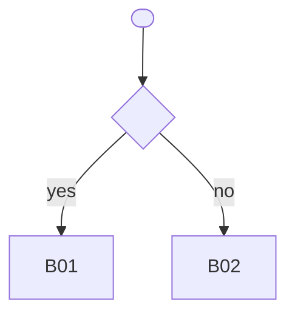

<!-- Template for pdd:study. Copy the block below into <unit>/AGENTS.md.
     If the file already exists: append the block (no markers present) or replace only
     what lies between the markers. Text outside the markers is human-owned; never touch it.
     Fill every placeholder. Delete a section only if you write why at the bottom of the block. -->

# <unit name>

<!-- study:begin -->
## Scope

<One paragraph: what callers get from this directory. Name the unit's job in the product, not its internal
structure. If this paragraph would also be true of a sibling directory, it is too generic to be useful.>

## Entry points

| Entry point | Invocation | Site |
| --- | --- | --- |
| <kind: HTTP / CLI / exported fn / event> | <the caller's invocation> | `<path>:<line>` |

## Branches

| id | branch | behaviour (observable) | trigger (quoted) | site | example | notes |
| --- | --- | --- | --- | --- | --- | --- |
| `B01` | <short name> | <what the caller observes> | `<quoted predicate>` + config `<key>=<default>` (`<path>:<line>`) | `<path>:<line>` | <one concrete input> | |
| `B02` | <the default path — never omit it> | <what the caller observes when nothing matches> | <the absence of the above predicates> | `<path>:<line>` | <input that matches nothing> | default |

## Selection paths



## Invariants and traps

- <rule that holds today and would not survive an innocent edit> — enforced at `<path>:<line>`
- <rule nobody enforces, which the code assumes> — not enforced

## Verify

```
<cheapest command that exercises this directory>
<one suite, scoped to this unit>
```

## Nested package roots

| Path | Why it is a separate unit | Round |
| --- | --- | --- |
| `<path>/` | <the entry point it owns> | 2 |

`None — this directory is a leaf; no deeper unit owns an entry point.`

## Provenance

- generated: `<40-char commit>` @ `<YYYY-MM-DD>`
- by: `pdd:study` round `<n>`          <!-- a refresh writes: delta `<base8>..<head8>` -->
- re-check: `python3 <plugin>/skills/study/scripts/check_agents_md.py <project_root>`
<!-- study:end -->
