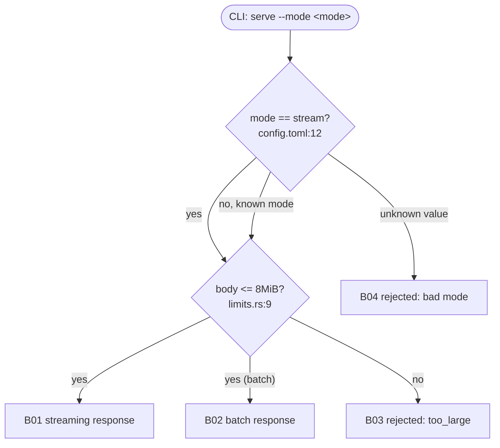

# The selection-path graph

The graph is not a picture of the code. It is a picture of **selection**: from an entry point, through the
predicates, to the branch that ends up running. A reader must be able to walk it and read the conjunction that
triggers any branch — which is exactly the table's `trigger` column, drawn.

## 1. Shape

A copy-paste source is in `references/mermaid-templates.md` §1; this section states the conventions it must obey.

One `flowchart TD` per entry point. Three node kinds, and nothing else:



Conventions, all of which the checker understands:

| Element | Rule |
| --- | --- |
| entry point | stadium node `(["..."])`, the invocation a caller makes, not a function name |
| predicate | rhombus `{"..."}`, the quoted predicate **plus its `file:line`** on a second line (`<br/>`) |
| branch | rectangle `["B<k> {behaviour}"]`, the id matching the table row exactly |
| edge label | the predicate's outcome that walks this edge — `yes`, `no`, or the value (`"mode=stream"`) |
| direction | `TD` (top-down) for a pipeline, `LR` when the chain is long and thin; one direction per file |

Node ids are `E<k>`, `P<k>`, `B<k>`: no spaces, no punctuation, never reused for two things. Labels may hold
any text, but a label containing `(`, `)`, `[`, `]`, `{`, `}`, `"`, `:` or `|` is the most common way to break a
mermaid block — either wrap the whole label in double quotes (`B01["B01 reject (400)"]`) or use the HTML entity
(`&lt;`, `&gt;`) for the brackets, as the example does for the CLI invocation.

## 2. What the graph must satisfy

- **Every table row appears exactly once as a terminal.** A branch without a terminal is a claim with no path;
  a terminal without a row is a path with no evidence.
- **Every terminal is reachable from an entry point.** An unreachable terminal is either `unreachable` in the
  table (a finding) or a drawing error.
- **Every edge carries its predicate outcome.** An edge labelled "else" or with no label loses the conjunction,
  which is the only thing the graph adds over the table.
- **Predicate nodes carry their `file:line`.** The graph is navigated by opening files; a node without a site
  sends the reader back to search.
- **No code in the nodes.** `P1{"mode == \"stream\""}` is fine; `P1{"let m = parse_mode(cfg)?; if m == ..."}` is
  a paste, and pastes go stale in a diagram nobody re-reads.

## 3. Reading a selection path off the graph

The path from the entry point to terminal `B0k` is the trigger: every predicate node on it, joined with `and`,
in order, with each edge's outcome applied (`yes` keeps the predicate, `no` negates it). If that sentence does
not equal the table's `trigger` cell, one of the two is wrong — and finding which is the point of writing both.

The tables and the graph are therefore one assertion in two shapes, and the acceptance step compares them.

## 4. Size discipline

A graph that needs scrolling is a graph nobody walks. Two moves, in this order:

1. **Split by entry point.** The file has several entry points; each gets its own graph, and the ones that
   share no predicate are never merged.
2. **Collapse a chain that shares one outcome.** Ten predicates that all lead to the same rejection become one
   predicate node labelled with the outermost guard, and the rest are listed in that branch's row `notes` —
   provided the collapse is stated, so the reader knows the table has the detail.

There is no node cap. The signal that a graph must be split is that a reader cannot answer "what triggers
`B07`?" by looking at it, and that signal appears long before any number does. A directory whose branch map
needs more than one screen is a directory that owns package roots: report them, and let the next round carry
the detail.

## 5. Validation

`scripts/check_agents_md.py` verifies the mechanical part of every block: a fenced ` ```mermaid ` block exists,
it starts with `flowchart`, node ids are well formed, ids are not declared twice with different labels, every
`B<k>` in the graph has a row, and every row has a `B<k>` in the graph.

A real render is better than a lint when a renderer is available:

```
npx -y @mermaid-js/mermaid-cli -i AGENTS.md -o /tmp/agents-render.svg   # whole file
```

If the render fails, the block is broken regardless of what the lint said — fix the label quoting first (it is
almost always a quote or a bracket), then the ids. Record in the report whether a render was run or only the
lint: the two are different strengths of evidence, and a reader is entitled to know which one they got.
