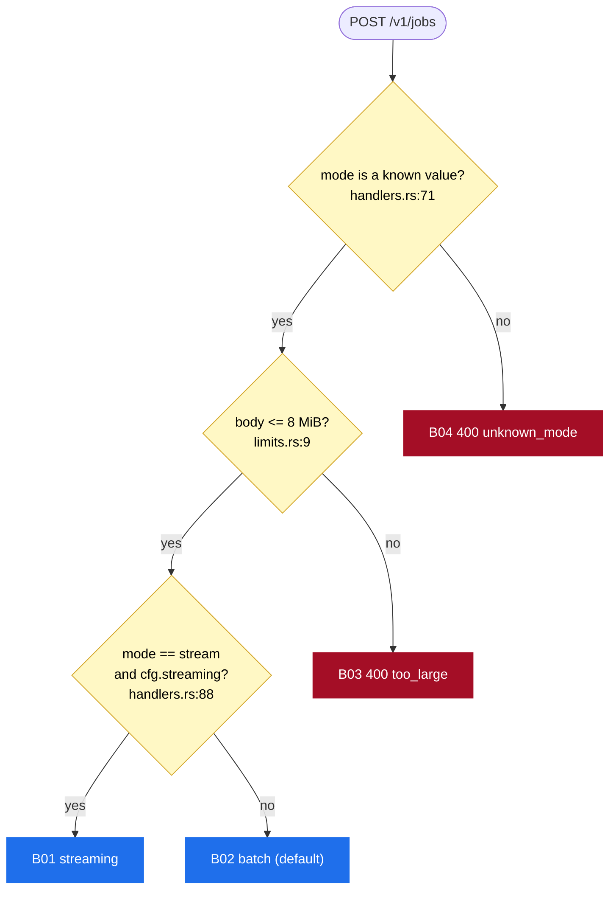
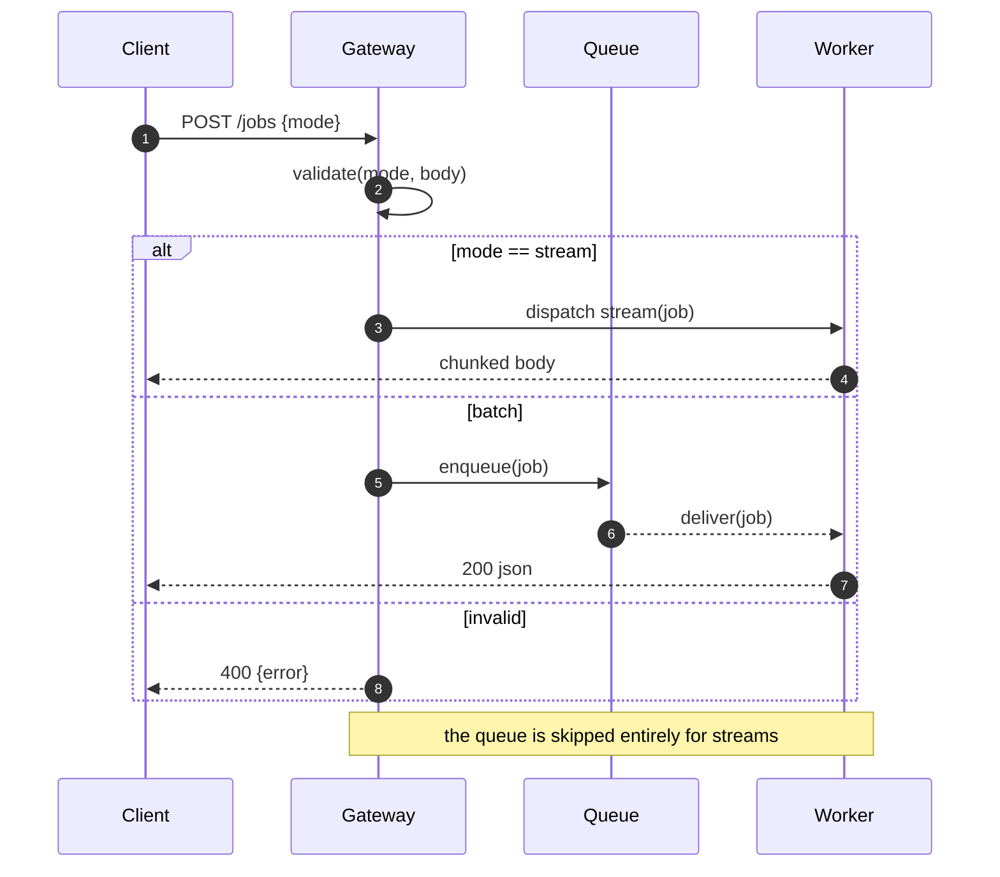
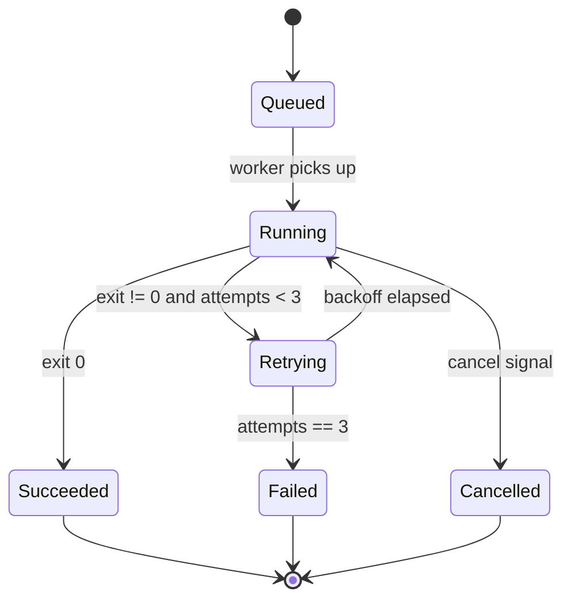
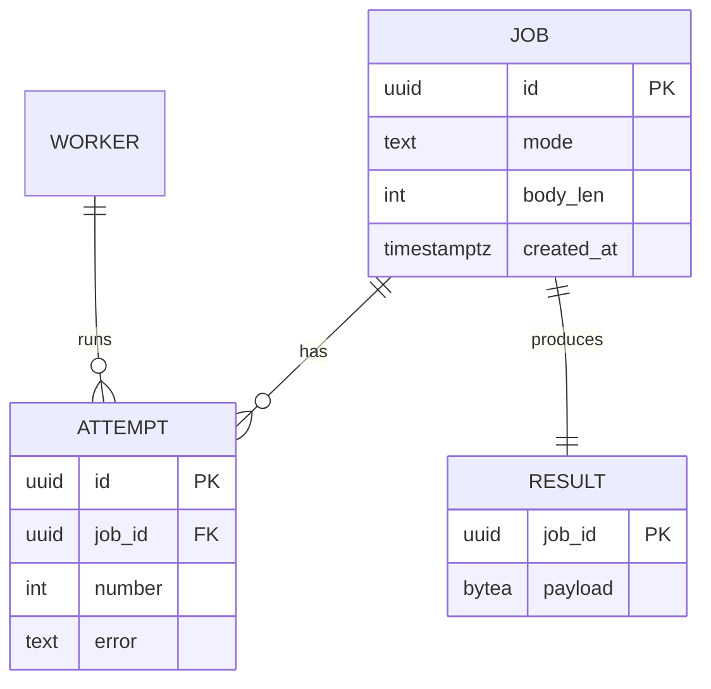
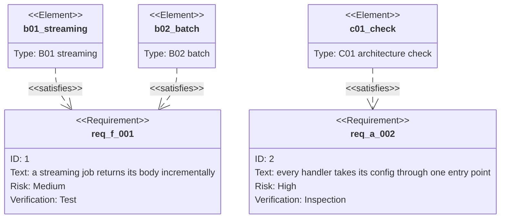
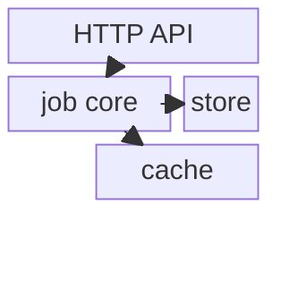
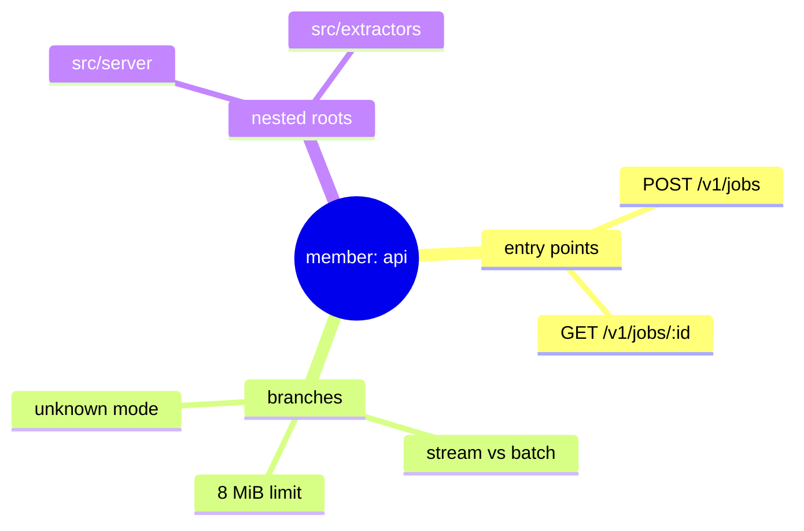

# Mermaid templates that work

Copy-paste sources, rendered and verified. Every block below was rendered with `mermaid-cli` 12.2.0 (mermaid
v12.2) before being written here; a template that did not render is not in this file.

Two rules for the study's own diagrams before any of this: the graph must agree with the branch table
(`references/mermaid-selection-path.md`), and a block that cannot be rendered is not evidence.

## 1. Selection path — the study's default

One per entry point: invocation → predicates (`file:line`) → branches, every edge labelled with its outcome.



Colours are decoration; the id prefix carries the meaning (`B01` = the table row). Never encode a distinction
in colour alone.

## 2. Call chain across actors

When the branch is decided by *who* is talking: request → validation → dispatch → worker, with the skipped
step visible.



## 3. State machine

Every branch that depends on the current state — and the transition that got there.



## 4. Type structure

When the branch is a variant of an enum or an implementation of a trait, the type tree *is* the branch list —
every variant is a row.

```mermaid
classDiagram
  class Job {
    +id: JobId
    +mode: Mode
    +body: Vec~u8~
    +run() Result~Outcome~
  }
  class Mode {
    <{enumeration}>
    Stream
    Batch
  }
  class Outcome {
    <{interface}>
    +bytes() Vec~u8~
  }
  class StreamingOutcome
  class BatchOutcome
  Job --> Mode
  Job ..> Outcome
  Outcome <|.. StreamingOutcome
  Outcome <|.. BatchOutcome
```

## 5. Data model

When a branch is about the shape of stored state: which row, which cardinality, which nullable.



## 6. Requirement trace

The inventory promoted one level: which branch serves which requirement, and which check answers it.



## 7. Swimlanes

When the branch crosses an ownership boundary: which actor decides, and where the handoff is.

```mermaid
swimlane-beta LR
  subgraph Caller
    request[POST /v1/jobs]
    receive[read response]
  end
  subgraph Gateway
    validate[validate mode]
    dispatch[dispatch]
    reject[400 too_large]
  end
  subgraph Worker
    run[run job]
    chunk[stream body]
    json[batch body]
  end
  request --> validate
  validate -->|"ok, stream"| run
  validate -->|"ok, batch"| dispatch
  validate -->|"body too large"| reject
  run --> chunk
  dispatch --> run
  run --> json
  chunk --> receive
  json --> receive
```

## 8. Service topology

For the `Scope` section when the unit is a service: what it talks to, and in which direction.

```mermaid
architecture-beta
  group api(cloud)[Public API]
  service gw(server)[Gateway] in api
  service q(queue)[Queue]
  service w(server)[Worker]
  service db(database)[Postgres]
  gw:R --> L:q
  q:R --> L:w
  w:R --> L:db
```



## 9. Layered structure

For an `Invariants` entry that is about direction (who may import whom).



## 10. Inventory mindmap

For the `Nested package roots` section: what the unit is made of, before the children are studied.



## Portability

| Tier | Types | Use |
| --- | --- | --- |
| stable (renders in GitHub, GitLab, VS Code, most viewers) | `flowchart`, `sequenceDiagram`, `classDiagram`, `stateDiagram-v2`, `erDiagram`, `gantt`, `pie`, `journey`, `gitGraph`, `requirementDiagram`, `timeline`, `mindmap`, `quadrantChart` | anything committed next to code |
| beta (syntax may move; older renderers reject it) | `block-beta`, `architecture-beta`, `packet-beta`, `radar-beta`, `kanban`, `swimlane-beta`, `treeView-beta`, `xychart-beta`, `sankey-beta`, `C4Context` | local documents, or once the renderer version is known |

A renderer's version can be checked from inside Markdown: a fenced block with the body `info` prints the
mermaid version it is using. Worth doing before committing beta syntax next to code.

## Syntax that actually bites

| Symptom | Cause | Correct form |
| --- | --- | --- |
| `radar` fails outright | wrong type name and wrong value syntax | `radar-beta`, axes as `axis a["Label"], b["Label"]`, values as `curve c["Name"]{1,2,3}` |
| `swimlanes` fails | there is no `lane` keyword | `swimlane-beta LR` plus one `subgraph {lane} … end` per lane |
| `architecture-beta` node error | missing icon type or group membership | `service gw(server)[Gateway] in api`; edges need handles: `gw:R --> L:q` |
| `requirementDiagram` arrow error | the verb must sit between the dashes | `b01_streaming - satisfies -> req_f_001` |
| label clipped or parse error | `( ) [ ] { } : \|` unquoted inside a label | quote the whole label: `B01["B01 400 (too_large)"]`; `<br/>` works inside quotes |
| graph too wide to read | too many nodes in one direction | split by entry point, or switch `TD` ↔ `LR` |

## Rendering

```bash
npx -y @mermaid-js/mermaid-cli -i block.mmd -o block.svg          # documents
npx -y @mermaid-js/mermaid-cli -i block.mmd -o block.png -b white # chat, slides
```

Render every block in a studied file before accepting it, one `npx -y @mermaid-js/mermaid-cli` run per
fence: a rendered image is the only form of "the diagram is fine" that is evidence. A block that fails to
render is reported as unrendered, never passed as lint-verified.
